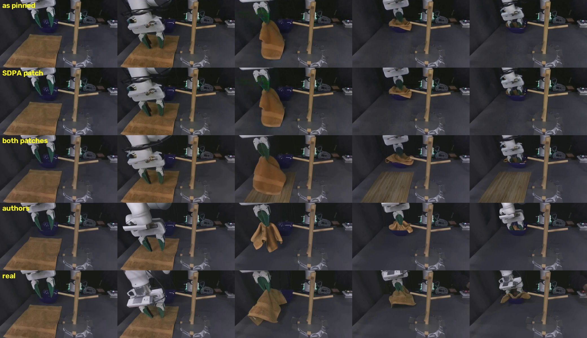
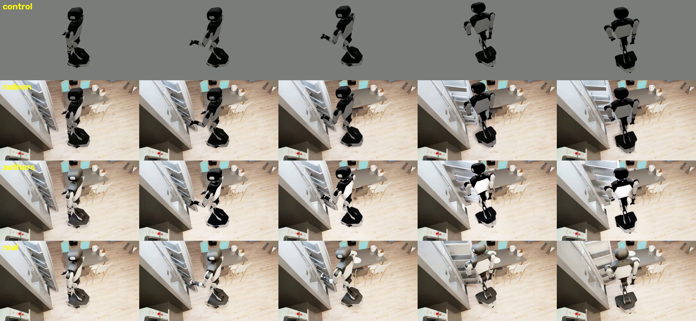

# Masked Visual Actions on one AMD Radeon Pro W7900

A single-GPU Radeon reproduction of [HadiZayer/masked-visual-actions](https://github.com/HadiZayer/masked-visual-actions) (Apache-2.0), the code release for *Masked Visual Actions for Unified World Modeling* by Hadi Alzayer, Wenlong Huang, Haonan Chen, Christopher Luey, Lvmin Zhang, Maneesh Agrawala, Gordon Wetzstein, Li Fei-Fei, Yilun Du, Jiajun Wu and Jia-Bin Huang ([arXiv:2607.19343](https://arxiv.org/abs/2607.19343), [project page](https://masked-visual-actions.github.io/)).

The model is a pair of LoRAs on [PAI/Wan2.2-Fun-A14B-Control](https://modelscope.cn/models/PAI/Wan2.2-Fun-A14B-Control), a two-expert 14B video DiT. Given a masked visual action (a rendered robot on a gray canvas), a reference frame and a prompt, it generates the RGB video of the scene responding to that action.

Upstream code is unchanged: `inference/`, `training/` and `LICENSE` are the authors' files at `95f7a33`, and their README is kept as [`UPSTREAM_README.md`](UPSTREAM_README.md). This repo adds `radeon/` (container, environment, two DiffSynth-Studio patches, weights, verification, profiling and single-card training scripts) and `results/` (logs, metrics and the generated clips).

## Results

One AMD Radeon Pro W7900D (gfx1100, 48 GiB); the container gets one render node and `torch.cuda.device_count()` is 1. Image `rocm/pytorch:rocm7.14_ubuntu24.04_py3.12_pytorch_release_2.11.0` (PyTorch 2.11.0+rocm7.14.0), DiffSynth-Studio at upstream's pinned `3743b13`. The path is upstream `inference/infer.py` with its own `--low-vram` flag and both released LoRAs, at its defaults: 832x480, 81 frames, 50 steps, CFG 5. Inputs are clips the authors published on the project page (see [Samples](#samples)); seeds come from the published file names.

Three configurations were run:

- **as pinned**: DiffSynth-Studio exactly at `3743b13`; the upstream path with no code change;
- **SDPA patch** (towel only): plus `diffsynth-wan-sdpa-contiguous.patch`;
- **both patches**: plus `diffsynth-wan-vae-attention-math.patch`. This is what `radeon/setup_env.sh` installs.

Metrics are over frames 1-80 (frame 0 is the reference). "Authors" is the clip the authors published for the same control video and seed; "still frame" is the reference frame held for all 80 frames.

| Clip | Pair | PSNR | SSIM | LPIPS |
| --- | --- | ---: | ---: | ---: |
| towel (real Franka, custom gripper, seed 123) | as pinned vs real | 23.60 | 0.887 | 0.173 |
| | SDPA patch vs real | 23.59 | 0.887 | 0.172 |
| | both patches vs real | 23.33 | 0.884 | 0.220 |
| | authors vs real | 22.84 | 0.876 | 0.169 |
| | as pinned vs authors | 24.43 | 0.901 | 0.139 |
| | both patches vs authors | 23.94 | 0.896 | 0.195 |
| | still frame vs real | 20.02 | 0.861 | 0.249 |
| behavior (R1 Pro in BEHAVIOR-1K, seed 456) | as pinned vs real | 18.28 | 0.849 | 0.117 |
| | both patches vs real | 18.47 | 0.860 | 0.107 |
| | authors vs real | 19.57 | 0.861 | 0.113 |
| | as pinned vs authors | 21.30 | 0.899 | 0.087 |
| | both patches vs authors | 21.51 | 0.912 | 0.072 |
| | still frame vs real | 20.63 | 0.880 | 0.127 |

For scale, the paper reports PSNR 22.79 / SSIM 0.864 / LPIPS 0.148 on its 13 real-world clips and 22.90 / 0.843 / 0.123 on 50 BEHAVIOR clips. Two clips are not a benchmark. What they show is that this path on this card lands where the authors' own outputs land on the same inputs, and that every Radeon clip is closer to the authors' clip than either is to the real video. On the behavior clip a still frame beats every generation on PSNR and SSIM (static camera, small robot); only LPIPS ranks the generated clips above it.

The one number that moves is towel with both patches. The VAE patch changes the control latents a little (it fixes the VAE attention, below), and from the same seed the sampler then completes the patch of table under the lifted towel, which the reference frame never shows, as a wooden board instead of the dark tabletop. The paper names this failure: artifacts in regions unseen in the reference frame. On behavior the same patch moves every metric toward the real video and toward the authors' clip.



| | as pinned | both patches |
| --- | ---: | ---: |
| 50 denoising steps (two DiT forwards each) | 1 h 52 min, 134 s/step | 1 h 03 min, 75.4 s/step |
| Wall time, model load to saved mp4 (towel / behavior) | 6818 s / 6816 s | 3857 s / 3856 s |
| VRAM in use while denoising | 41.1 GiB of 48 | 41.2 GiB of 48 |
| Host RSS peak | 7.6 GiB | 7.7 GiB |



## What it took on Radeon

**Memory.** The two experts are 2 x 26.6 GB in bf16, more than the card holds. Upstream's `--low-vram` keeps weights memory-mapped from disk, loads the active expert into host RAM and moves each layer to the GPU on first use until usage reaches the card's size minus 2 GB; the other expert is dropped at the switch (timestep 875, step 21 of 50). In this mode the LoRAs are not merged: each wrapped linear adds `x @ A.T @ B.T`, and both 2.3 GB LoRAs stay on the GPU.

**Attention speed** (`radeon/patches/diffsynth-wan-sdpa-contiguous.patch`). DiffSynth's Wan DiT uses FlashAttention 3/2 or SageAttention when installed and otherwise falls back to `torch.nn.functional.scaled_dot_product_attention`. None of the three exists for gfx1100, so the fallback is the hot path. PyTorch 2.11 on ROCm dispatches SDPA to its AOTriton flash kernel without any flag, at 61 TFLOPS for this model's 34,320-token self-attention ([probe](results/logs/probe_attention.log)). But DiffSynth hands SDPA a strided view (`b s (n d) -> b n s d`, the layout FlashAttention wants), and on gfx1100 that view runs at 20 TFLOPS; `.contiguous()` first gets 56 TFLOPS including the copy, with bit-identical output ([probe](results/logs/probe_layout.log)). Kernel profile of one DiT forward ([as pinned](results/profile_towel_unpatched.json), [patched](results/profile_towel_patched.json)):

| One DiT forward | total | attention | GEMM | copies | rest |
| --- | ---: | ---: | ---: | ---: | ---: |
| as pinned | 67.5 s | 48.2 s | 16.0 s | 1.9 s | 1.3 s |
| SDPA patch | 37.9 s | 17.1 s | 16.7 s | 2.7 s | 1.3 s |

With only this patch the 50-step towel run took 1 h 03 min instead of 1 h 52 min. Its frames differ from the as-pinned run by a mean of 1.3 of 255 gray levels (PSNR 41.8 dB); attention alone is bit-identical, so the difference comes from elsewhere in the kernel stack. Its metrics against the real video are unchanged (23.59 / 0.887 / 0.172).

**VAE attention correctness** (`radeon/patches/diffsynth-wan-vae-attention-math.patch`). The Wan VAE has one single-head attention with 384 channels in its mid-block. On this stack the fused SDPA kernels give wrong results at head size 384: on random inputs, NaN or values off by up to 3e38 at every length tried (1,560 to 6,240 tokens), some not even repeatable, while head size 128 is accurate ([probe](results/logs/probe_vae_attention.log)). In the VAE itself, with tiling as `infer.py` uses it, the fused results are off by up to 28 where the exact values stay below 1.4; the control latents move by 0.075 on average, decoded pixels differ from the exact kernel at 40.7 dB, and an encode-decode round trip loses 1 dB (36.98 vs 37.97 dB). Untiled, as DiffSynth's training encodes, the same kernel sometimes writes NaN into the latents ([probe](results/logs/probe_vae_encode.log)). The patch runs that one call through the exact math kernel; the VAE's speed does not visibly change.

**DiffSynth's file redirect.** `WanVideoPipeline.from_pretrained` silently swaps the PAI repo's `models_t5_umt5-xxl-enc-bf16.pth` and `Wan2.1_VAE.pth` for safetensors copies in `DiffSynth-Studio/Wan-Series-Converted-Safetensors` (`redirect_common_files=True`). With downloads disabled, the missing copies show up as `Cannot detect the model type. File: []`. `radeon/download_weights.sh` fetches the converted files, so the run loads what an online run loads.

**Environment.** A venv created from the image's `/opt/venv` does not see its ROCm PyTorch until the image site-packages path is added with a `.pth` file. DiffSynth is installed with `--no-deps` so pip cannot swap in a CUDA torch.

## Training on one card

`radeon/train_control_1gpu.sh` is upstream's `training/train_control.sh` (same base model, LoRA rank 256 and targets, 480x832, learning rate, checkpoint cadence and timestep bands) changed only where one card requires it:

- one process instead of `--multi_gpu`;
- DiffSynth's own split training (`sft:data_process`, then `sft:train`): T5 and the VAE encode each clip once, and training loads only the DiT expert. In one stage, T5 + VAE + a 14B expert + rank-256 LoRA state fill the card before any activation, and `--offload_models` on T5 fails in this DiffSynth version (`Unexpected key(s) in state_dict: "weight"` for its embedding). The cache stores the timestep band and checkpointing flags of the encode stage, so both stages get them;
- gradient checkpoints in host RAM (`--use_gradient_checkpointing_offload`);
- `NUM_FRAMES`: at upstream's 81 frames one step peaks at 44.1 GiB before Adam allocates its 4.6 GiB of state, which does not fit 48 GiB.

DiffSynth's trainer also always builds a `Wav2Vec2Processor` from `Wan-AI/Wan2.2-S2V-14B` (online it would download about 4 GB of an English speech model for this video-only model); `radeon/download_weights.sh` fetches the four small files the processor needs.

Smoke run ([log](results/logs/train_smoke_f49.log)): the low-noise expert, the three sample clips, one epoch, `NUM_FRAMES=49`, both patches. Encoding the clips took under a minute; the three optimisation steps took 137, 121 and 120 s with VRAM peaking at 44.1 GiB, losses 0.054, 0.207 and 0.160 (each step draws its own timestep in the 0.358-1 band), and the run wrote `step-3.safetensors` with 800 tensors of the same shapes as the released LoRA (`lora_A` 256 x 5120, bf16). This shows the recipe runs on one card; it says nothing about how well 49-frame training would reproduce the authors' LoRAs, whose data is not released.

## Reproduce on one card

```bash
# host: workdir with this repo as src/, one render node into the container
git clone https://github.com/charyang-ai/masked-visual-actions.git /data/mva/src
bash /data/mva/src/radeon/start_container.sh /data/mva /dev/dri/renderD128

# weights, about 72 GB, SHA-256 checked (HF_ENDPOINT=https://hf-mirror.com if needed)
bash /data/mva/src/radeon/download_weights.sh /data/mva

# samples from the project page
git clone https://github.com/masked-visual-actions/masked-visual-actions.github.io /data/mva/site
python /data/mva/src/radeon/make_samples.py /data/mva/site /data/mva/data/samples

# inside the container
docker exec -it radeon-masked-visual-actions bash
bash src/radeon/setup_env.sh                        # venv, DiffSynth-Studio at 3743b13, both patches
venv/bin/python src/radeon/probe_attention.py       # SDPA backends at Wan2.2-A14B size
bash src/radeon/run_verify.sh smoke                 # 2 steps, both experts, ~6 min
bash src/radeon/run_verify.sh full towel behavior   # 50 steps each, ~1 h each
```

Run long jobs inside `tmux` on the host so they survive a dropped SSH session. `NO_PATCH=1 bash src/radeon/setup_env.sh` leaves DiffSynth as pinned. LPIPS uses torchvision's AlexNet weights; put `alexnet-owt-7be5be79.pth` under `cache/torch/hub/checkpoints/` if the container cannot reach download.pytorch.org.

## Samples

The project page publishes, for several clips, exactly what `infer.py --save-inputs` writes (`*_control.mp4`, `*_reference.png`) next to the generated clip and the real video, all at 832x480, 81 frames, 15 fps. `radeon/make_samples.py` packs three of them:

| Sample | Control | Seed | Reference |
| --- | --- | --- | --- |
| towel | `ablation_actions/our_real_world/towel/render_ep02_seed123_control.mp4` | 123 | frame 0 of the real video |
| behavior | `comparison_with_baselines/BEHAVIOR/ep50/rendering_000501_seed456_control.mp4` | 456 | frame 0 of the real video |
| failure1 | `failure_cases/example1/ep00_seed123_control.mp4` | 123 | published `ep00_seed123_reference.png` |

The page does not publish prompts. The paper trains on one high-level prompt per clip so the model relies on the visual condition; the prompts here are short task descriptions. That, and frame 0 of a web-encoded video standing in for the original reference, is why the Radeon clip is close to, but not identical with, the authors' clip despite the same seed (DiffSynth draws the initial noise on the CPU). failure1 is used only by the training smoke.

## Files

```text
radeon/start_container.sh       one container, one render node, workdir at /workspace
radeon/setup_env.sh             venv on the image's ROCm torch, DiffSynth at 3743b13, patches
radeon/patches/                 diffsynth-wan-sdpa-contiguous.patch, diffsynth-wan-vae-attention-math.patch
radeon/download_weights.sh      base model, converted T5/VAE, tokenizer, LoRAs, SHA-256 checked
radeon/make_samples.py          samples from the project page
radeon/probe_attention.py       SDPA backends and one GEMM at Wan2.2-A14B size
radeon/probe_layout.py          strided vs contiguous q/k/v for SDPA
radeon/probe_vae_attention.py   fused SDPA vs fp32 reference at the VAE's head size 384
radeon/probe_vae_encode.py      fused vs exact VAE attention on real latents and pixels
radeon/run_verify.sh            upstream infer.py: 2-step smoke and 50-step runs, timing, VRAM, metrics
radeon/metrics.py               PSNR / SSIM / LPIPS(alex) against real and published clips
radeon/compare_runs.py          two generated clips, frame by frame
radeon/profile_step.py          per-forward timing and a kernel profile of one denoising step
radeon/train_control_1gpu.sh    upstream's training recipe on one card
radeon/train_loss_log.py        loss and peak VRAM per step for DiffSynth's train.py
results/                        logs, metrics, profiles, generated clips
```

## License

Apache-2.0, inherited from upstream (see `LICENSE`). Model weights are not included: the base model is PAI's Wan2.2-Fun-A14B-Control and the LoRAs are the authors' [HadiZayer/masked-visual-actions](https://huggingface.co/HadiZayer/masked-visual-actions).
